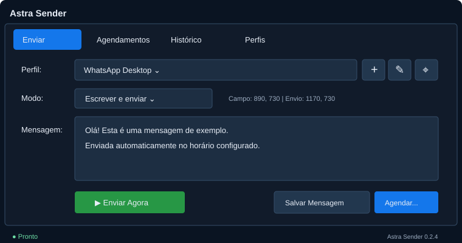
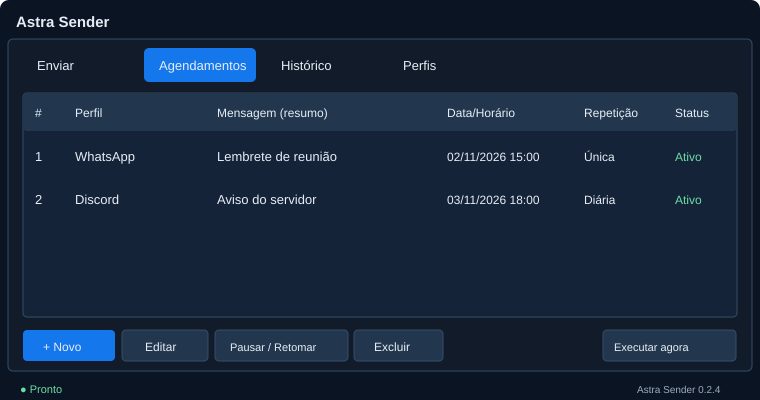
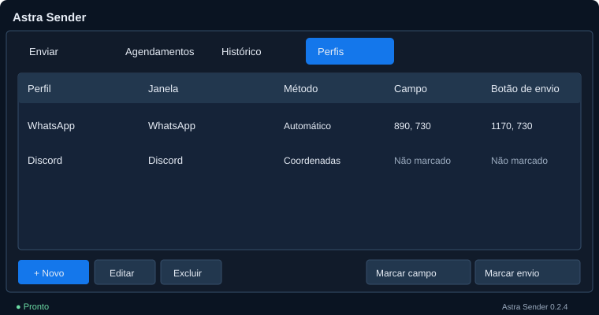
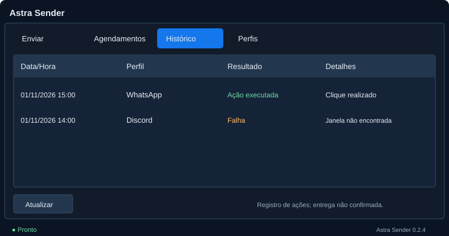

<div align="center">

# Astra Sender

**Suas mensagens. No horário certo.**

Automação de mensagens para Windows, com perfis independentes,<br>
agendamentos e uma interface que mantém tudo ao alcance.


**[Baixar para Windows](https://github.com/2ksllvwr/Astra-Sender/releases)** · **[Primeiros passos](#primeiros-passos)** · **[Desenvolvimento](docs/desenvolvimento.md)**

<br>



<sub>Ilustração da interface 0.2.4. Os dados apresentados são exemplos.</sub>

</div>

<br>

## Uma rotina, vários destinos

Crie um perfil para cada aplicativo e selecione sua janela. Depois, use a mesma configuração para uma mensagem imediata ou uma tarefa agendada.

| Organize | Programe | Acompanhe |
| :--- | :--- | :--- |
| Perfis com aplicativo, mensagem e pontos de interação próprios. | Execuções únicas, diárias ou semanais, com opção de pausar e retomar. | Histórico das ações executadas e dos erros encontrados. |

## Baixar e usar

Abra **[Releases](https://github.com/2ksllvwr/Astra-Sender/releases)** e escolha a compilação mais recente que tenha arquivos disponíveis.

| Arquivo | Como usar |
| :--- | :--- |
| **`AstraSender.exe`** | Baixe e execute. Não precisa instalar Python. |
| `AstraSender-versao-em-pasta.zip` | Extraia todo o conteúdo e abra `AstraSender.exe`, mantendo os arquivos juntos. |
| `SHA256SUMS.txt` | Consulte os hashes para conferir a integridade do download. |

As compilações da branch principal são identificadas como **pré-versões**. Como o repositório é privado, entre na conta com acesso para visualizar os downloads.

## Primeiros passos

1. Abra **Perfis → + Novo** (ou edite um perfil antigo).
2. Escolha **Janela + colar + Enter** e selecione o destino em **Janelas abertas**. Use **Atualizar** se acabou de abrir o aplicativo.
3. No Discord, deixe **Campo de texto** vazio para detecção automática do compositor. **Detectar campos** preenche o nome automaticamente quando encontra um único compositor; se houver vários, permite escolher. Para outros aplicativos, selecione o campo de mensagem, não a pesquisa.
4. Autorize o uso do mouse/teclado e salve. Não é necessário marcar o botão de envio.
5. Em **Enviar**, escreva a mensagem e escolha **Enviar Agora** ou **Agendar…**.

### Discord

A versão 0.2.7 corrige a leitura do rótulo de acessibilidade: o conteúdo vazio da caixa não é mais usado como nome do campo.

A detecção automática reconhece o compositor pelo rótulo de mensagem, independentemente dos caracteres do nome do canal: letras estilizadas do Messletters, kanjis, emojis e marcas combinantes não precisam ser digitados manualmente. Ao fixar um destino, o nome é normalizado com Unicode NFKC e espaços/caracteres de formatação invisíveis; os enfeites visíveis são preservados para não confundir canais distintos.

O aplicativo desktop é reconhecido pelo processo. Opcionalmente, informe o link `https://discord.com/channels/...` e abra esse chat antes de salvar. Se o campo estiver vazio, o Astra tenta detectar seu nome ao salvar, para conferir o destino no envio. A abertura pelo link usa um protocolo do cliente e é **experimental**. O nome do campo é verificado antes de colar; não use nomes genéricos quando houver destinos parecidos.

O modo restaura a janela minimizada e precisa do foco do teclado. Envia com a conta conectada no aplicativo; não é uma integração em segundo plano. Envios para destinos diferentes são sequenciais. O campo deve estar vazio: o programa cancela diante de um rascunho existente, campo ambíguo ou mudança de foco. Aplicativos que não exponham o campo e seu conteúdo pela acessibilidade podem ser incompatíveis.

> Deixe o Astra Sender em execução para processar os agendamentos. Perfis antigos conservam o método anterior até serem editados. Os métodos por coordenadas continuam disponíveis.

## Quatro abas, uma interface direta

### Enviar

O perfil, a mensagem e os controles principais ficam na mesma tela. Escolha entre **Escrever e enviar** ou **Somente enviar**, quando o texto já estiver preparado no aplicativo de destino.

### Agendamentos

Veja as tarefas em uma lista e abra o formulário para ajustar horários e recorrência. Pause, retome ou exclua uma tarefa conforme sua rotina.



<details>
<summary><strong>Conheça as abas Perfis e Histórico</strong></summary>

### Perfis

Mantenha configurações separadas para cada destino, incluindo pontos de interação e método de automação.



### Histórico

Consulte a data, o perfil utilizado e o resultado de cada tentativa. Uma ação executada registra a interação feita pelo programa; não confirma o recebimento da mensagem.



</details>

<sub>As imagens desta página são ilustrações do programa, não capturas de testes em aplicativos externos.</sub>

## Atualizações sem compilação manual

Cada atualização enviada à `main` aciona o **GitHub Actions**. O processo executa os testes no Windows, gera as duas distribuições e publica os arquivos em Releases somente após uma compilação bem-sucedida.

**[Acompanhar compilações](https://github.com/2ksllvwr/Astra-Sender/actions)** · **[Ver versões disponíveis](https://github.com/2ksllvwr/Astra-Sender/releases)**

Para atualizar, feche o programa e substitua o executável ou a pasta da aplicação pela nova versão. O download e a instalação ainda são manuais; a geração dos arquivos é automática.

## Seus dados continuam com você

Perfis, mensagens salvas, tarefas e histórico são armazenados localmente em SQLite, fora da pasta do executável:

```text
%LOCALAPPDATA%\AstraSender\astra_sender.db
```

Na primeira execução, o Astra Sender tenta importar o banco antigo do PySender, quando disponível, sem apagar o original. Faça uma cópia do banco com o aplicativo fechado antes de atualizar.

## Antes de agendar

- A automação funciona no Windows e depende dos controles disponíveis no aplicativo de destino.
- No modo por coordenadas, mantenha a janela na posição marcada. O programa poderá utilizar o mouse e o teclado durante a execução.
- A tela bloqueada, o computador desligado ou uma janela minimizada podem impedir a tarefa.
- A versão está em **beta**. Valide o envio com um destino de teste antes de usá-la na sua rotina.

---

<div align="center">

**Astra Sender**<br>
<sub>Projeto independente. Sem afiliação com WhatsApp, Discord, Telegram ou seus desenvolvedores.</sub>

</div>


### Horário do disparo (0.2.8)

Os agendamentos mostram segundos e os novos horários começam em `:00`.
No método **Janela + colar + Enter**, a preparação começa até 12 segundos antes:
restaurar a janela, localizar o campo e colar o texto. Deixe mouse, teclado e chat
livres nesse período. O Enter aguarda o horário local; não há garantia de entrega
no mesmo segundo no servidor. O histórico registra o instante de solicitação
do Enter e o atraso local em milissegundos. Atrasos acima de um segundo cancelam
o disparo, podendo deixar o texto preparado como rascunho.
Envios simultâneos continuam sequenciais, pois usam o mesmo teclado.
Os métodos antigos por mouse/UIA não fazem preparação antecipada.
Se a detecção falhar, abra **Perfis → Diagnóstico** e copie o relatório de
controles para análise. Ele não consulta o conteúdo das mensagens, mas os
rótulos podem conter nomes de canais.
